# DineFlow

Multi-tenant restaurant POS, kitchen, and inventory platform.


Live demo: [dineflow-saas-taupe.vercel.app](https://dineflow-saas-taupe.vercel.app)

## Overview

DineFlow is a point of sale and back office system for restaurants, built to host many restaurants on one deployment. Every restaurant works in its own space: its own menu, orders, staff, customers, inventory, and reports. Restaurant data routes are scoped to the logged in user's restaurant, so one restaurant never reaches another's data.

It fits small and mid sized restaurants that want the counter, the kitchen screen, and stock control in one place.

How it is used:

- The platform owner logs in as super admin, into a separate panel. From there the super admin creates a restaurant, picks the plan (Basic or Pro), sets the status (trial, active, suspended) and the trial length, and sets the first admin account with an email and password.
- The super admin hands those credentials to the restaurant owner. The owner logs in as restaurant admin and sets up categories, menu items, tables, and staff.
- The admin creates staff accounts with a role (manager, cashier, waiter, kitchen) and chooses which dashboard modules each account can open. Permissions start from role defaults and can be adjusted per account.

Roles in the system: `super-admin`, `restaurant-admin`, `manager`, `cashier`, `waiter`, `kitchen`.

## Features

**POS and orders**

- Dine-in, takeaway, and delivery orders
- Dine-in keeps a running tab on the table: more items can be added to the same open order in later rounds, each round tagged for the kitchen
- Per item discounts and coupon codes
- Split payments across cash, card, online, and credit, with change calculation
- Item prices, stock, tax, and discounts are recalculated on the server, never taken from the browser
- Order history with status, type, payment, date, and text filters, plus status changes and payment collection where the role allows

**Kitchen and waiter screens**

- Kitchen display with live tickets over Ably, status flow from pending through preparing to ready, and a sound alert on new orders
- Waiter screen listing items that are ready to serve, with a sound alert and a toast when an order item becomes ready
- Both screens have a history tab
- Notification feed on both screens for new orders and low stock items, with read state kept in the browser

**Tables**

- Tables with number, capacity, and status: available, occupied, reserved
- Status follows the open order on that table, and can also be toggled by hand
- Counters for total, available, occupied, and reserved tables

**Inventory and recipes**

- Inventory items with unit, cost per unit, current stock, and reorder level
- Recipes attached to menu items: selling an item deducts the ingredients, scaled by portion size
- Menu items are marked unavailable when an ingredient runs out, and come back automatically once a purchase order restocks it
- Orders are rejected if there is not enough stock to make them
- Low stock and out of stock counts, plus total stock value

**Purchase orders and suppliers**

- Supplier records with contact details
- Purchase orders with status pending, received, or cancelled, and payment status unpaid, partially paid, or paid
- Receiving a purchase order adds the quantities to stock and writes an expense entry under supplies

**Customers and credit**

- Customer records with phone lookup during order creation
- Credit payments that build a balance on the customer, which can be settled from the customers page
- Customer order history

**Coupons**

- Percentage or fixed amount discount
- Minimum order amount, optional maximum discount cap, and expiry date
- Active toggle per coupon, validated on the server at checkout

**Reports**

- Eight reports: financial overview, cash and ledger detail, category sales, best sellers, peak hours, staff performance, customer report, and supplier report
- Date range filtering and charts

**Expenses**

- Expenses under rent, utilities, salaries, maintenance, supplies, or other, with amounts and dates

**Receipts and settings**

- Printable thermal receipt, with an optional barcode block and a footer message
- Receipts can be reprinted from order history
- Settings for restaurant name, address, phone, tax rate, currency symbol, receipt footer, barcode on receipt, sound alerts, and the urgent order threshold

**Super admin panel**

- Platform statistics: total restaurants, active, suspended, and trials
- Restaurant list with owner and order counts, plus create, edit, suspend, activate, delete, and reset admin password
- Demo requests from the landing page, tracked as new, contacted, or converted

**Plans, trials, and permissions**

- Two plans: Basic exposes a subset of modules, Pro unlocks all of them
- Trial status with an end date set by the super admin, plus suspended and cancelled states
- Login is refused when the trial has ended, or when the restaurant is suspended or cancelled
- Module permissions are checked on the routes and in the API, and the super admin routes are limited to the super admin role

**Also**

- Dark and light mode, remembered in the browser
- Layout adapts to phones and tablets, with a slide out navigation panel on small screens
- Login and demo request endpoints are rate limited
- Public landing page with the Basic and Pro plans and a demo request form. Each request is emailed to the platform owner and listed in the super admin panel

## Screenshots

<table>
  <tr>
    <td align="center"><strong>Landing page</strong></td>
    <td align="center"><strong>Login</strong></td>
    <td align="center"><strong>Dashboard, dark</strong></td>
  </tr>
  <tr>
    <td>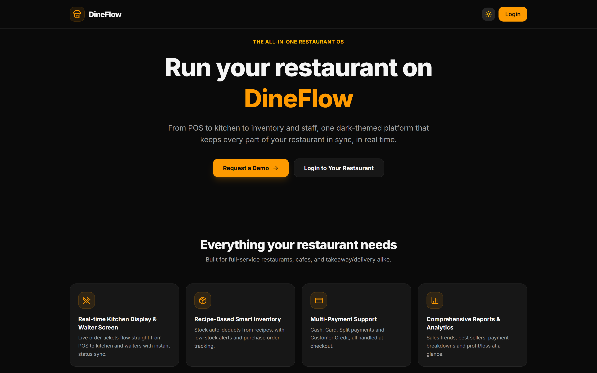</td>
    <td>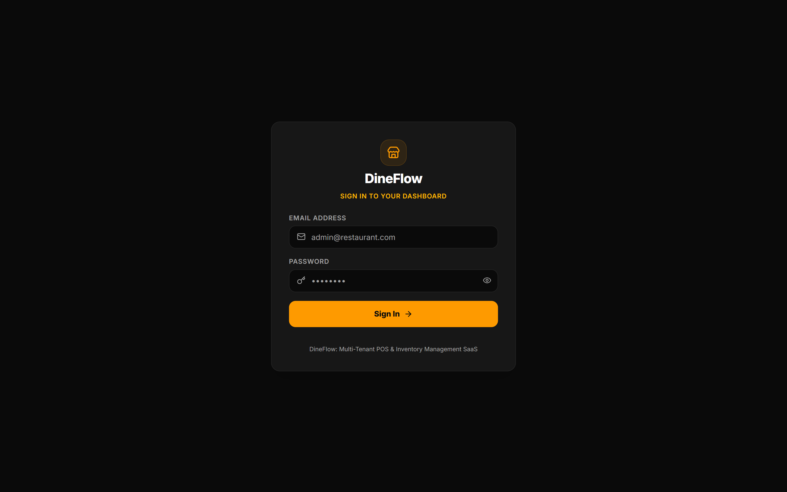</td>
    <td>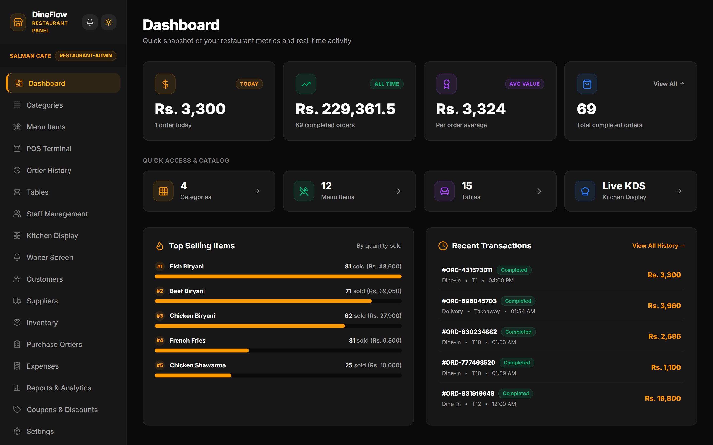</td>
  </tr>
  <tr>
    <td align="center"><strong>POS terminal</strong></td>
    <td align="center"><strong>Kitchen display</strong></td>
    <td align="center"><strong>Waiter screen</strong></td>
  </tr>
  <tr>
    <td>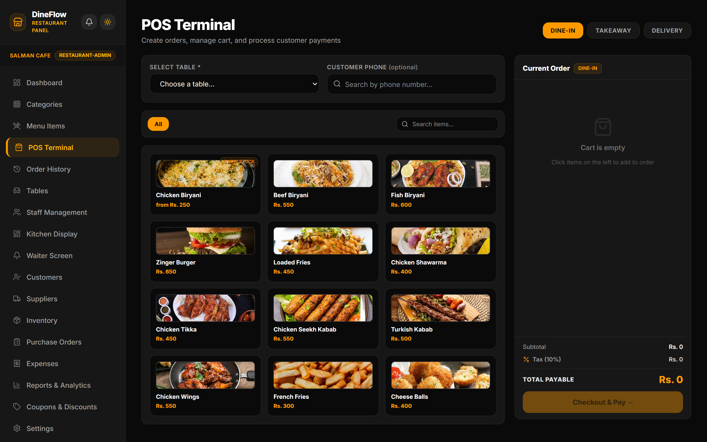</td>
    <td>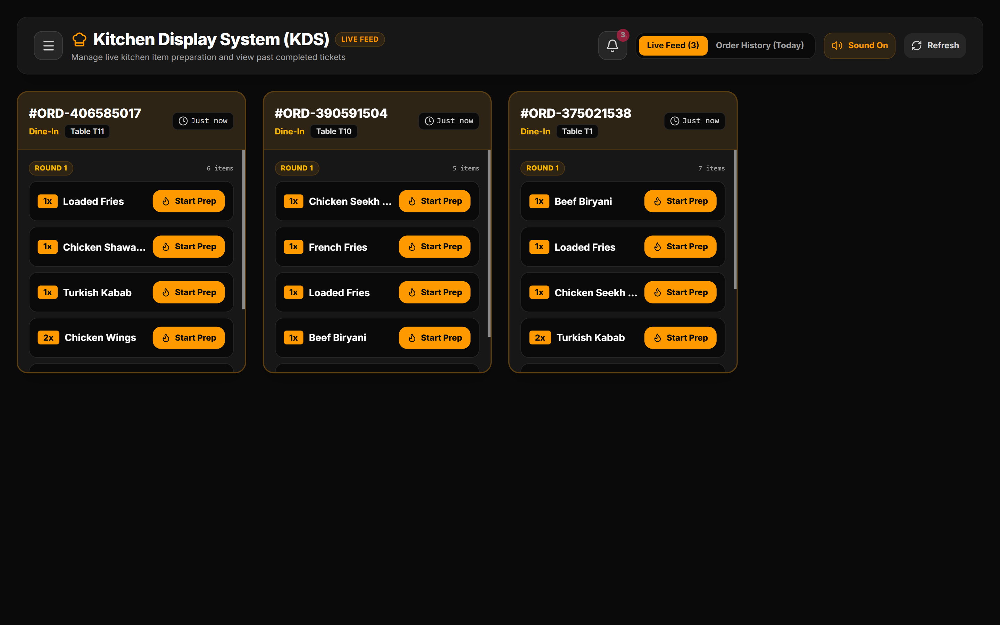</td>
    <td>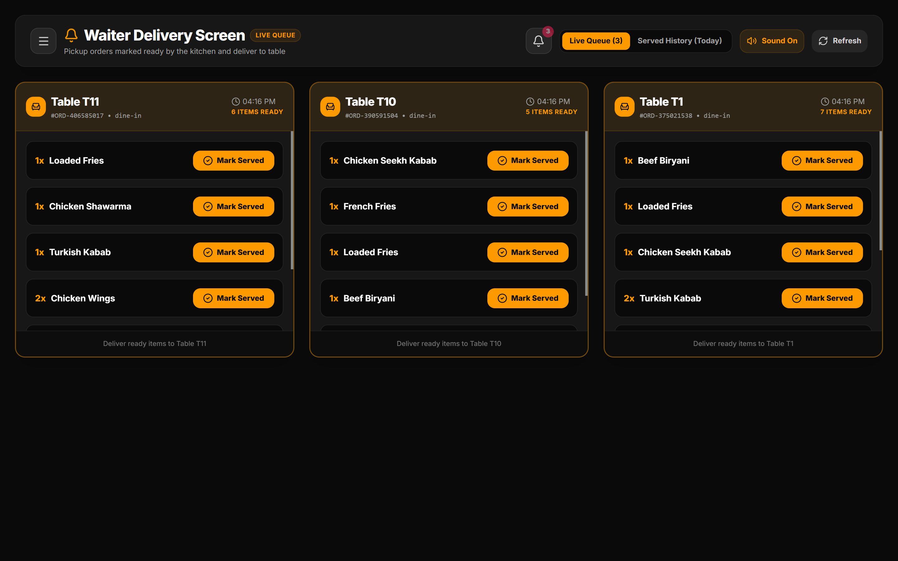</td>
  </tr>
  <tr>
    <td align="center"><strong>Order history</strong></td>
    <td align="center"><strong>Receipt</strong></td>
    <td align="center"><strong>Inventory</strong></td>
  </tr>
  <tr>
    <td>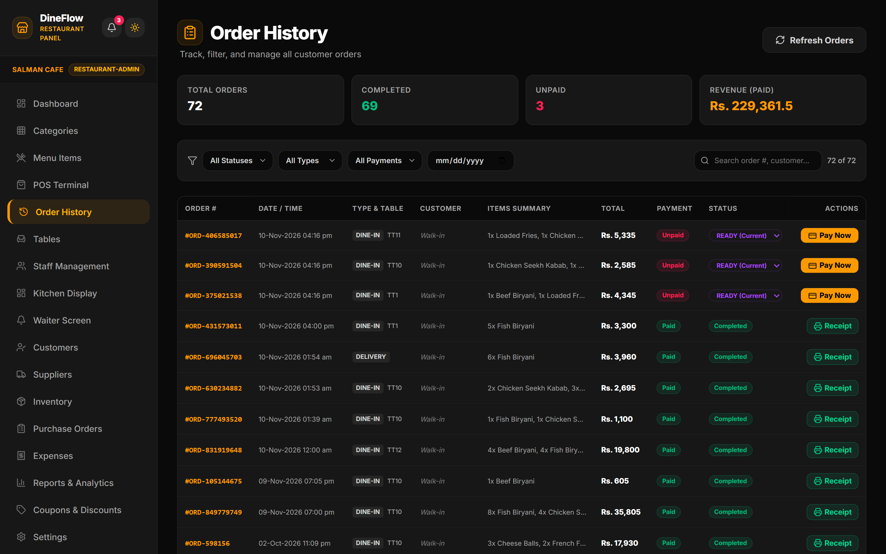</td>
    <td>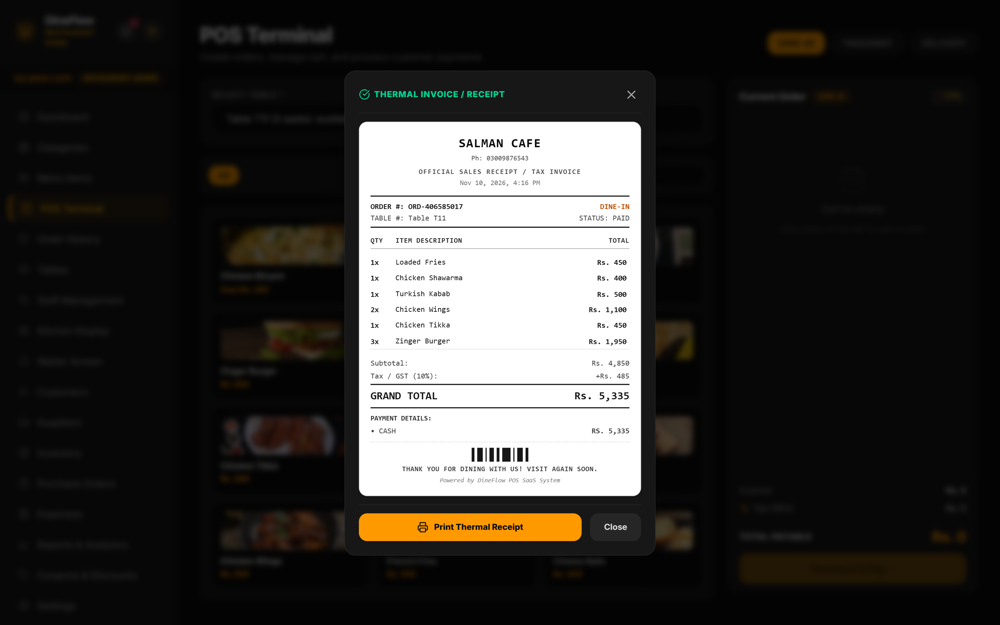</td>
    <td>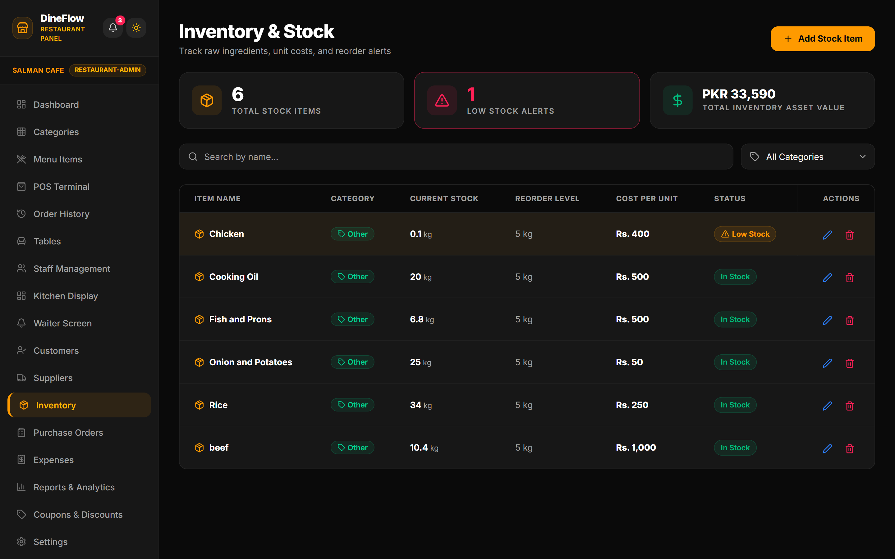</td>
  </tr>
  <tr>
    <td align="center"><strong>Tables</strong></td>
    <td align="center"><strong>Dashboard, light</strong></td>
    <td align="center"><strong>Phone view</strong></td>
  </tr>
  <tr>
    <td>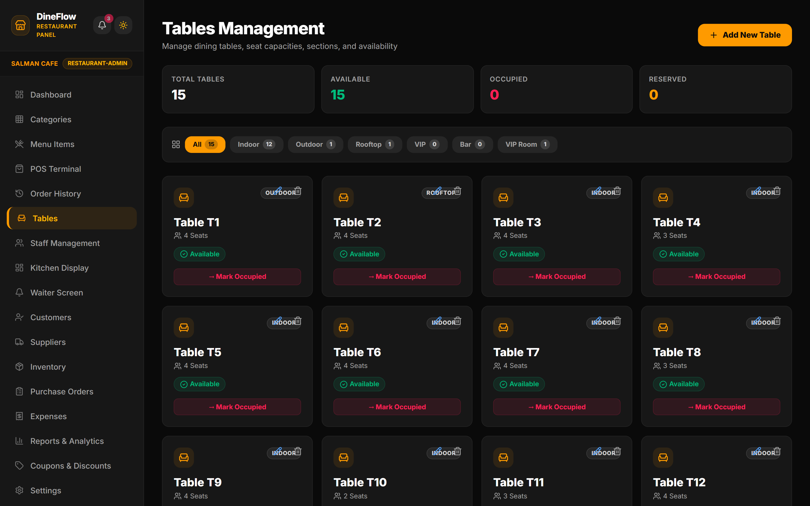</td>
    <td>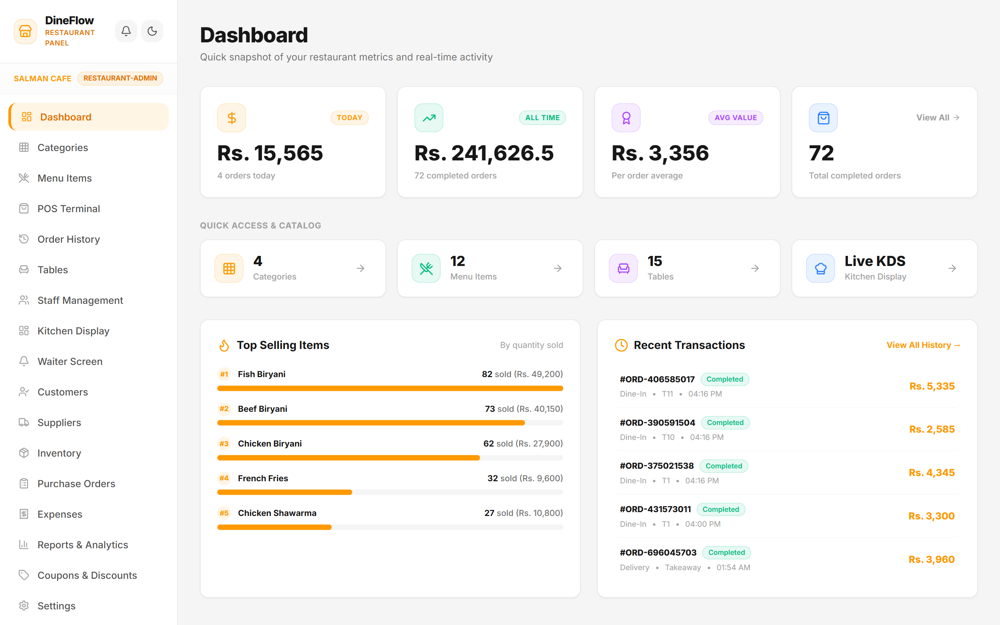</td>
    <td>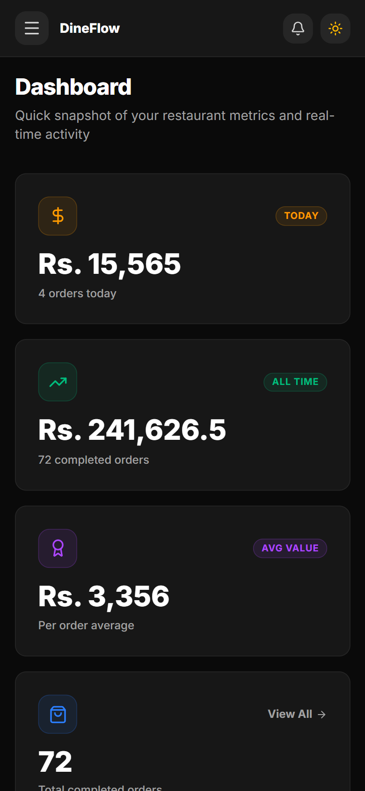</td>
  </tr>
</table>

The screenshots show demo data that was entered through the app itself. This repo has no seed script.

## Getting started

You need Node.js, a MongoDB database (Atlas works), and an Ably API key for the realtime screens.

**Clone**

```bash
git clone https://github.com/fahadmusa725/pos-saas.git
cd pos-saas
```

**Backend**

```bash
cd backend
npm install
cp .env.example .env
```

On Windows PowerShell use `Copy-Item .env.example .env`.

Fill in the values in `backend/.env`. The variable names are:

```
PORT
MONGO_URI
JWT_SECRET
NODE_ENV
SUPER_ADMIN_EMAIL
SUPER_ADMIN_PASSWORD
CLIENT_URL
EMAIL_HOST
EMAIL_PORT
EMAIL_USER
EMAIL_PASS
EMAIL_FROM_NAME
NOTIFY_EMAIL
ABLY_API_KEY
```

`CLIENT_URL` is the allowed frontend origin. The email variables are only used to send the new demo request notification. `ABLY_API_KEY` needs publish capability, because the backend sends events with it.

Create the super admin account, using `SUPER_ADMIN_EMAIL` and `SUPER_ADMIN_PASSWORD` from the same file:

```bash
npm run create-superadmin
```

Then start the API:

```bash
npm run dev
```

`npm start` runs the same server without nodemon.

**Frontend**

```bash
cd frontend
npm install
```

Create `frontend/.env` with one variable, pointing at the API:

```
VITE_API_URL=http://localhost:5000/api
```

A production build fails on purpose if `VITE_API_URL` is missing.

```bash
npm run dev
```

Vite serves the app on `http://localhost:5173`.

## Project structure

```
pos-saas/
├── backend/    Express API, MongoDB models and controllers, Ably publishing, Vercel entry
└── frontend/   React single page app (Vite, Tailwind)
```

## Deployment

- Frontend on Vercel as a static build. `frontend/vercel.json` rewrites every path to `index.html` so client side routes work on refresh.
- Backend on Vercel as a serverless function. `backend/index.js` exports the Express app without listening and reuses the MongoDB connection between invocations. `backend/server.js` is the local entry.
- Realtime on Ably. The backend publishes to a `restaurant:<id>` channel, and the browser subscribes with a short lived token from `/api/realtime/token`.
- Database on MongoDB Atlas.

## Author

Fahad Musa
